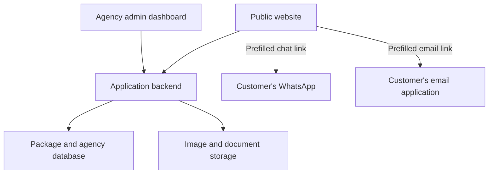

# Travel Agency Package Website — Architecture

Version: 0.2  
Status: Initial draft  
Website model: Browse packages and contact the agency through WhatsApp or email  
Technology stack: To be decided

## 1. Purpose

Display all published travel packages. Customers open a package to read its details,
then click a WhatsApp or email button to contact the agency with a prefilled message
containing the selected package's basic details.

The customer reviews and sends the message in WhatsApp or their email application.
Opening either application does not mean a message has been sent.
The agency handles the conversation, quote, and booking directly with the customer.

## 2. First-version features

| Customer website                                               | Agency admin dashboard                            |
| -------------------------------------------------------------- | ------------------------------------------------- |
| View all published packages                                    | Sign in securely                                  |
| See a photo, package name, and duration on each card           | Create, edit, publish, and archive packages       |
| Click View Details to open a package                           | Manage package photos and optional itinerary PDFs |
| Read the itinerary, inclusions, exclusions, and price guidance | Update agency information and contact details     |
| Click Enquire on WhatsApp                                      | Configure the agency WhatsApp number              |
| Click Enquire by Email                                         | Configure the agency email address                |

The first version has no website enquiry form, enquiry records, enquiry statuses,
customer accounts, or online payments.

## 3. Architecture

Use one application with clearly separated modules. The public website and admin
dashboard share a backend for package content. These are logical components and
can be deployed together.



| Component                    | Responsibility                                                         |
| ---------------------------- | ---------------------------------------------------------------------- |
| Public website               | Display packages and construct contact links from the selected package |
| Admin dashboard              | Manage packages, photos, agency information, and contact settings      |
| Backend                      | Serve published packages and authorize staff content changes           |
| Database                     | Store package content, agency settings, and staff identities           |
| Media storage                | Store photos and optional itinerary PDFs                               |
| WhatsApp / email application | Let the customer review and send the prefilled enquiry                 |

Contact buttons use links; a WhatsApp messaging API or backend email-sending service
is not required for this flow.

## 4. Pages

| Page            | Purpose                                                                                                      |
| --------------- | ------------------------------------------------------------------------------------------------------------ |
| Home            | Introduce the agency and highlight packages                                                                  |
| Packages        | Show all published packages as cards with a photo, name, days/nights, and View Details button                |
| Package details | Show photos, duration, itinerary, inclusions, exclusions, price guidance, and WhatsApp/email enquiry buttons |
| About           | Explain the agency and its services                                                                          |
| Contact         | Show agency phone, WhatsApp, and email details                                                               |
| Privacy notice  | Explain website data use and the external contact options                                                    |
| Admin login     | Authenticate agency staff                                                                                    |
| Admin packages  | Manage package content and publishing                                                                        |
| Admin settings  | Manage agency information, WhatsApp number, and email address                                                |

Separate destination listing and destination details pages are not needed initially.

### Example package cards

- Leh Tour — 5 Days / 4 Nights — View Details
- Leh–Nubra Tour — 6 Days / 5 Nights — View Details
- Leh–Nubra–Pangong Tour — 7 Days / 6 Nights — View Details

These are sample labels. The agency sets each package's actual days and nights.

## 5. Customer contact workflow

1. Customer browses the package cards.
2. Customer clicks View Details on a package.
3. The details page shows the itinerary and contact buttons.
4. Customer selects Enquire on WhatsApp or Enquire by Email.
5. The selected application opens with the package details already in the message.
6. Customer can edit the message, add dates or group size, and send it.
7. The agency replies directly through that channel.

No enquiry status diagram or website enquiry tracking is used in this version.

## 6. Prefilled enquiry message

Build the message from the package currently being viewed. Use the same basic
content for WhatsApp and email.

```text
Hello, I am interested in this travel package:

Package: Leh–Nubra Tour
Package ID: PKG-002
Duration: 6 Days / 5 Nights
Package link: <public URL of this package>

Please share availability and the final quote.

Preferred travel dates: ( comment intead of asking customer for dates and no of travells doesnt seems nice  )
Number of travellers:

```

Suggested email subject: `Package enquiry: Leh–Nubra Tour (PKG-002)`.
comment : add details like travel dates and number of travellers here only
If a starting price is published, it may also be included with its currency and
“starting from” label. Do not invent a price for packages priced on request.

### Button behavior

| Button              | Action                                                                        |
| ------------------- | ----------------------------------------------------------------------------- |
| Enquire on WhatsApp | Open a WhatsApp chat addressed to the agency with the encoded package message |
| Enquire by Email    | Open a mailto link addressed to the agency with an encoded subject and body   |

- Use the configured agency contact details for both buttons.
- Store the WhatsApp number with its country code and format it correctly for the link.
- Encode the message, email subject, and email body so spaces, line breaks, and special characters work.
- Use the package's public link, not an admin or local development link.
- Show the agency email address and a Copy Details option as a fallback if no email application is configured.
- Do not show “Enquiry sent” after a click: the website cannot confirm that the customer sent the message.

## 7. Data model

| Record  | Main fields                                                                                                                                                                                                                                                        |
| ------- | ------------------------------------------------------------------------------------------------------------------------------------------------------------------------------------------------------------------------------------------------------------------ |
| Package | id, title, slug, places_covered, duration_days, duration_nights, description, itinerary, inclusions, exclusions, starting_price (optional), currency, price_note, publication_status, image_references, itinerary_pdf_reference (optional), created_at, updated_at |

| AgencySettings | agency_name, about_text, phone, whatsapp_number, email, address, social_links |
| AdminUser | id, name, email, authentication_identity, active |

- Each package can cover multiple places, such as Leh, Nubra, and Pangong.
- Store days and nights separately so the displayed duration matches the actual package.
- Package IDs and slugs must be unique.
- Visitors can access published packages only.
- Starting prices are guidance; the agency confirms the final quote in conversation.

## 8. Application modules

| Module          | Responsibilities                                         |
| --------------- | -------------------------------------------------------- |
| Catalogue       | List packages, show details, and manage publishing       |
| Contact links   | Build the selected package's WhatsApp and email messages |
| Authentication  | Staff sign-in, sessions, and access control              |
| Media           | Authorized image and PDF uploads                         |
| Agency settings | Manage public agency content and contact information     |

All package and settings changes require staff authentication.
Public responses must exclude staff credentials and authentication data.

## 9. Suggested documentation folder

Store this file as `docs/architecture.md`.

- `README.md` — Project overview and, later, local setup instructions.
- `docs/architecture.md` — Components, customer flow, and data model.
- `docs/features.md` — Features and acceptance criteria.
- `docs/decisions.md` — Decisions, dates, and reasons.
- `docs/roadmap.md` — Build stages and progress.

These are suggested files; this draft updates only the architecture document.

## 10. Build order

1. Confirm agency branding, actual packages, WhatsApp number, and email address.
2. Build the package listing and package details pages with sample content.
3. Add the WhatsApp and email buttons with package-specific messages.
4. Add package storage, staff authentication, and admin editing.
5. Add About, Contact, and agency settings.
6. Test mobile layout, keyboard access, package publishing, and contact links.
7. Deploy and test the complete flow with the agency.

Before launch, use HTTPS, protect staff sessions, validate content changes, restrict
media uploads, and back up the database. Keep credentials outside source control.

### Contact-flow checks

- Each button includes the package currently being viewed.
- Days, nights, package ID, and public link match the selected package.
- WhatsApp opens the correct agency chat.
- Email opens with the correct recipient, subject, and body.
- Special characters and line breaks remain readable.
- Fallback contact details are available when an application cannot open.
- Opening a contact application does not produce a false “sent” confirmation.

## 11. Decisions still open

- Frontend and backend frameworks.
- Database and hosting provider.
- Staff sign-in method.
- Image storage provider.
- Whether prices are shown or supplied only on request.
- Actual package content and agency branding.

Record each choice in `docs/decisions.md` once agreed.

## 12. Possible later additions

- Package filters and search.
- Itinerary downloads.
- Reviews and multilingual content.
- Website enquiry forms, quote preparation, or booking records if the agency needs them later.
